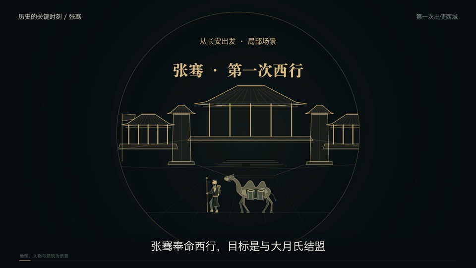
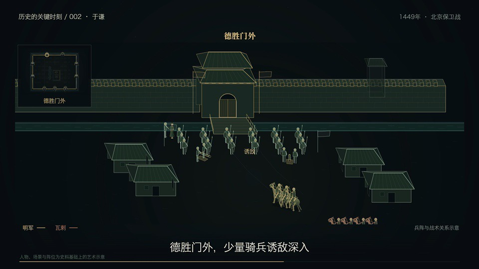
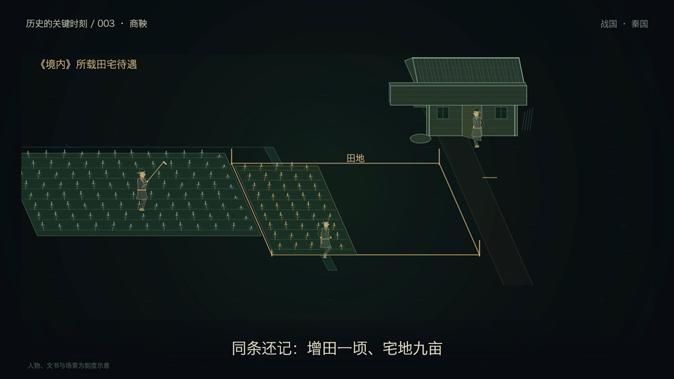

# Historical Knowledge Videos · 历史知识可视化

Three short, code-driven history visualizations by Fengrui Zhang, made with AI assistance. Maps, stylized characters, coordinated movement and visible changes in objects explain a journey, a city's defense, and an institutional process. The videos use Chinese captions and a shared soundtrack.

Fengrui Zhang 的三集历史知识短视频，使用代码驱动画面并借助 AI 辅助制作。通过地图、人物行动、物件状态和场景关系解释历史事件与制度，画面以中文呈现。这是成片展示合集，不是制作源工程的开源仓库。

**[Portfolio case / 双语案例](https://fury0831.github.io/projects/history-videos.html) · [Release and all downloads / 完整成片合集](https://github.com/fury0831/historical-knowledge-videos/releases/tag/v1.0)**

| Episode / 主题 | Duration / 时长 | Size / 大小 | Full video / 原始成片 |
| --- | --- | --- | --- |
| Zhang Qian — First Journey West / 张骞第一次西行 | 80 s | 52.82 MiB | [Download MP4 / 下载完整成片](https://github.com/fury0831/historical-knowledge-videos/releases/download/v1.0/01-zhang-qian-v6.mp4) |
| Yu Qian — Defending Beijing / 于谦与北京保卫战 | 88 s | 52.19 MiB | [Download MP4 / 下载完整成片](https://github.com/fury0831/historical-knowledge-videos/releases/download/v1.0/02-yu-qian-v3.mp4) |
| Shang Yang — Military Merit and Rank / 商鞅军功与爵位 | 96 s | 71.82 MiB | [Download MP4 / 下载完整成片](https://github.com/fury0831/historical-knowledge-videos/releases/download/v1.0/03-shang-yang-v2.mp4) |

GitHub Release links download the original MP4 files; browser handling varies. Open a downloaded file in a compatible video player. There is no autoplay or embedded third-party player. Large video files are stored as Release assets, not in Git history.

GitHub Release 链接提供原始 MP4，浏览器可能直接下载；下载后可用兼容播放器观看。页面不会自动加载三段视频，也没有第三方播放器嵌入。大视频保存在 Release 附件中，不进入 Git 历史。

## Three visual questions · 三种视觉问题

### 01 · 张骞 / Zhang Qian

How can an interrupted journey and an unsuccessful alliance still change what a court knows? The film follows the first westward mission through maps and local scenes, distinguishing travel, captivity, the unfulfilled alliance, and knowledge brought back. Route and location graphics are schematic, not a recovered exact itinerary.

用地图与局部场景呈现首次西行、被扣留、继续旅程、结盟未成和见闻带回。路线及地理位置为示意，不把推测路径当作逐步复原。

### 02 · 于谦 / Yu Qian

How do decisions, supply and coordinated defense connect? The film uses the 1449 crisis, the choice to defend the capital, preparations and the relationship between troops and city gates to show organized action. Stylized positions and movement communicate relationships, not exact historical formations or unit counts.

围绕 1449 年危局、守城决策、调兵备粮与城门外战术关系，展示有序协同。人物、兵阵、城墙和运动用于解释关系，不声称准确复原编制、人数或全部战场细节。

### 03 · 商鞅军功 / Shang Yang

What changes when military merit is recorded? The film separates recording merit, conferring rank, land/housing benefits and command appointments. Characters handling records and changes in status carry the explanation. Receiving a rank is not presented as automatically becoming a general; documents and scenes are institutional illustrations.

以人物办理事项与状态变化区分军功核定、授爵、田宅待遇和任官。新版强调“获爵并非自动成为将军”；文书和场景属于制度示意，不是实际秦代固定文书的复原。

## Files, provenance and scope · 文件与范围

- Original final music-backed files are preserved byte for byte. English asset names are used for stable links; `videos.json` maps them to the selected original filenames.
- The Yu Qian file retains “配乐预览” in its original filename, but it is the final music-backed version selected for this publication.
- Shang Yang uses the newer **v2 action-and-narrative version**, explicitly selected for publication; the older film is not uploaded.
- Production code, old cuts, silent versions, internal reviews, music source files, isolated audio, purchase records and personal information are excluded.
- `SHA256SUMS` records the three complete MP4 hashes. `videos.json` records size and technical metadata. Covers are extracted frames, not newly illustrated promotional images.

三个成片保留原始字节，英文附件名只为稳定链接；原文件名映射见 `videos.json`。于谦虽保留“配乐预览”原名，仍是本次确认的最终配乐版本。商鞅使用另行确认的最新 v2 动作与叙事版。旧片、无声片、工程源码、内部校对、独立音乐和私人材料不在本次公开范围内。

## Music and rights · 配乐与权利

Music: **《千年之后》 — 艾拉拉、Luv4** (the recording identified as “氛围版” in the production records). The publisher confirmed that these final videos may be publicly released. This statement is not an independent audit of copyright documentation.

**The music and complete MP4 files are not MIT-licensed.** No collection-wide open-source license is granted. See [RIGHTS.md](RIGHTS.md) for the separation between the final videos, embedded music, covers and production source. This repository does not grant a license to extract or independently redistribute the music.

配乐及整片不采用 MIT。音乐权利归相关权利人，发布者已确认本次成片可以公开；我们不据此宣称独立审验了版权文件。具体边界见 [RIGHTS.md](RIGHTS.md)。

## Validation limits · 验证边界

Publication preparation checked file size, SHA-256, H.264/AAC track metadata and sampled frames. These checks do not constitute a complete historical reconstruction, a full frame-by-frame review, or an independent music-rights audit. Playback and final deployment evidence are recorded separately by the publisher.

本次发布核对大小、哈希、音视频轨道与关键帧；不将这些检查表述为全帧人工审查、完整史实复原或独立音乐版权审核。
